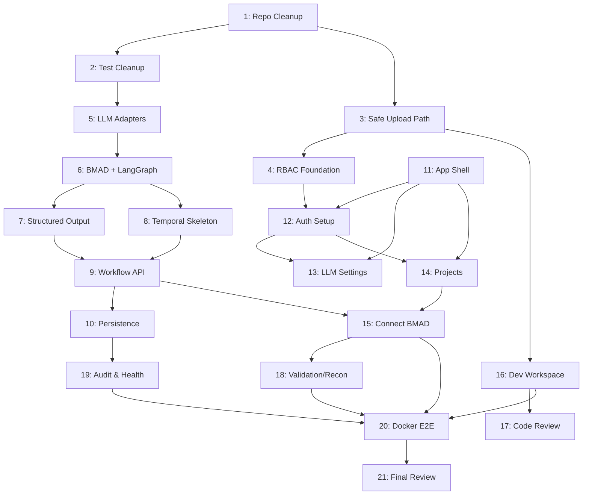

# Helix Migration — MVP Implementation Prompts

> **Product:** Helix Migration  
> **Repository:** helix-ai-migration  
> **Website:** helix.datainteg.io  
> **Tagline:** Open-source AI-powered migration and validation platform.

---

## Table of Contents

- [Official References](#official-references)
- [Phase 1: Foundation & Health](#phase-1-foundation--health)
  - [Prompt 1: Repository Cleanup & Baseline Health](#prompt-1-repository-cleanup--baseline-health)
  - [Prompt 2: Test Cleanup — No Real External LLM Calls](#prompt-2-test-cleanup--no-real-external-llm-calls)
- [Phase 2: Security & Core Infrastructure](#phase-2-security--core-infrastructure)
  - [Prompt 3: Security — Safe Artifact Upload Path](#prompt-3-security--safe-artifact-upload-path)
  - [Prompt 4: Organization Isolation & RBAC Foundation](#prompt-4-organization-isolation--rbac-foundation)
  - [Prompt 5: LLM Provider Adapter Cleanup](#prompt-5-llm-provider-adapter-cleanup)
- [Phase 3: Agent Runtime](#phase-3-agent-runtime)
  - [Prompt 6: Real BMAD + LangGraph Implementation Skeleton](#prompt-6-real-bmad--langgraph-implementation-skeleton)
  - [Prompt 7: PydanticAI-Compatible Structured Output Runtime](#prompt-7-pydanticai-compatible-structured-output-runtime)
  - [Prompt 8: Temporal Workflow / Activity / Worker Skeleton](#prompt-8-temporal-workflow--activity--worker-skeleton)
- [Phase 4: Backend Integration](#phase-4-backend-integration)
  - [Prompt 9: Backend Workflow Service & API](#prompt-9-backend-workflow-service--api)
  - [Prompt 10: Agent Output & Workflow Persistence](#prompt-10-agent-output--workflow-persistence)
- [Phase 5: Frontend](#phase-5-frontend)
  - [Prompt 11: Frontend Premium App Shell](#prompt-11-frontend-premium-app-shell)
  - [Prompt 12: Auth & First Admin Setup](#prompt-12-auth--first-admin-setup)
  - [Prompt 13: Admin LLM Provider Settings](#prompt-13-admin-llm-provider-settings)
  - [Prompt 14: Project Creation & Requirement Intake](#prompt-14-project-creation--requirement-intake)
  - [Prompt 15: Connect Requirement Intake to BMAD Workflow](#prompt-15-connect-requirement-intake-to-bmad-workflow)
- [Phase 6: Developer Workspace & Code Review](#phase-6-developer-workspace--code-review)
  - [Prompt 16: Developer Workspace Foundation](#prompt-16-developer-workspace-foundation)
  - [Prompt 17: Code Review Agent Draft Flow](#prompt-17-code-review-agent-draft-flow)
- [Phase 7: Validation, Audit & Observability](#phase-7-validation-audit--observability)
  - [Prompt 18: Basic Validation & Reconciliation Foundation](#prompt-18-basic-validation--reconciliation-foundation)
  - [Prompt 19: Audit Logs & System Health](#prompt-19-audit-logs--system-health)
- [Phase 8: Deployment & Final Review](#phase-8-deployment--final-review)
  - [Prompt 20: Docker Compose End-to-End Validation](#prompt-20-docker-compose-end-to-end-validation)
  - [Prompt 21: Full MVP Consistency & Safety Review](#prompt-21-full-mvp-consistency--safety-review)

---

## Official References

| Resource | URL |
|---|---|
---

## How to Use This Prompt File

> ⚠️ **Run one prompt at a time.** Do not run all prompts together.

**Recommended workflow per prompt:**

1. Copy the prompt text from this file
2. Paste it into Codex / Cursor / Claude in the IDE
3. Review all changed files before committing
4. Run the test commands listed under **Test Commands**
5. Verify tests and build pass
6. Commit using the **Suggested Commit Message**
7. Move to the next prompt

**Execution order recommendation:**

| Order | Prompts | Reason |
|---|---|---|
| 1 | Prompts 1–5 | Backend + security cleanup (no frontend needed yet) |
| 2 | Prompt 11 | Frontend app shell (can run independently in parallel) |
| 3 | Prompts 6–10 | Agent runtime + backend workflow integration |
| 4 | Prompts 12–15 | Auth, providers, projects, BMAD connection |
| 5 | Prompts 16–17 | Developer workspace + code review |
| 6 | Prompts 18–19 | Validation, reconciliation, audit, health |
| 7 | Prompt 20 | Docker Compose end-to-end |
| 8 | Prompt 21 | Final MVP review |

Each prompt is **intentionally scoped** to avoid overbuilding and architecture drift.

| BMAD Method (repo) | https://github.com/bmad-code-org/BMAD-METHOD |
| BMAD Docs | https://docs.bmad-method.org/ |
| LangGraph (repo) | https://github.com/langchain-ai/langgraph |
| LangGraph Docs | https://docs.langchain.com/oss/python/langgraph/overview |
| LangGraph Quickstart | https://docs.langchain.com/oss/python/langgraph/quickstart |
| PydanticAI (repo) | https://github.com/pydantic/pydantic-ai |
| PydanticAI Output Docs | https://pydantic.dev/docs/ai/core-concepts/output/ |
| Pydantic Docs | https://docs.pydantic.dev/ |
| Temporal OSS (repo) | https://github.com/temporalio/temporal |
| Temporal Python SDK | https://github.com/temporalio/sdk-python |
| Temporal Python Docs | https://docs.temporal.io/develop/python |
| Next.js Docs | https://nextjs.org/docs |
| Tailwind CSS Docs | https://tailwindcss.com/docs |
| shadcn/ui Docs | https://ui.shadcn.com/ |
| React Flow Docs | https://reactflow.dev/ |
| Docker Compose Docs | https://docs.docker.com/compose/ |

---

## Phase 1: Foundation & Health

---

### Prompt 1: Repository Cleanup & Baseline Health

#### Prerequisites

Read these files before making changes:

- `README.md`
- `AGENTS.md`
- `DEVELOPMENT.md`
- `ARCHITECTURE.md`
- `DATABASE_DESIGN.md`
- `SECURITY.md`
- `DOCKER_GUIDE.md`
- `docs/mvp/MVP_SCOPE.md`
- `docs/mvp/CODEX_TASKS.md`
- `docs/project-planning/TECHNICAL_EXECUTION_PLAN.md` (if exists)
- `docs/project-planning/RELEASE_CHECKLIST.md` (if exists)

Also inspect:

- `frontend/`
- `backend/`
- `worker/`
- `agents/`
- `docker-compose.yml`
- `docker-compose.dev.yml`
- `backend/requirements.txt`
- `worker/requirements.txt`

#### Architecture Direction

| Layer | Technology |
|---|---|
| Frontend | Next.js + TypeScript + Tailwind CSS + shadcn/ui |
| Backend | FastAPI + PostgreSQL + Redis + Alembic + Pydantic |
| Agent Runtime | BMAD methodology + LangGraph + PydanticAI |
| Workflow Runtime | Temporal OSS |
| Deployment | Docker + Docker Compose |
| Metadata DB | PostgreSQL |
| Artifact Files | Local storage (MVP), MinIO/S3 (later) |

#### Goal

Apply only P0 repository cleanup and baseline health fixes.

#### Scope

| # | Task |
|---|---|
| 1 | Add or update root `.gitignore` |
| 2 | Remove generated/build/runtime files from the repository |
| 3 | Add missing backend dependency: `email-validator>=2.0.0` |
| 4 | Add `worker/Dockerfile` if missing |
| 5 | Ensure `docker-compose.dev.yml` references existing Dockerfiles |

##### Files to Remove

```
frontend/.next
frontend/node_modules
backend/.pytest_cache
backend/test.db
backend/data/artifacts
All __pycache__/
All *.pyc
.DS_Store
coverage/
dist/
build/
*.log
```

##### Required `.gitignore` Entries

```gitignore
__pycache__/
*.pyc
.pytest_cache/
*.db
.env
.env.local
frontend/.next/
frontend/node_modules/
backend/data/
.DS_Store
dist/
build/
coverage/
*.log
```

#### Constraints

- ❌ Do not implement new product features
- ❌ Do not modify architecture decisions
- ❌ Do not change frontend UI pages (except to fix build errors)

#### Acceptance Criteria

- [ ] Generated files are removed from git tree
- [ ] `backend/requirements.txt` includes `email-validator`
- [ ] `worker/Dockerfile` exists if `docker-compose.dev.yml` expects it
- [ ] `docker-compose.dev.yml` references valid Dockerfiles
- [ ] No new product feature is added
- [ ] No uploaded code execution is added

#### Deliverables

- Show changed files
- Show removed generated files
- Run backend tests (if possible)
- If tests fail, summarize exact failure
- Stop after this task

#### 🛑 Stop Condition

If the task requires changing more than the defined scope above, **stop** and explain why instead of continuing. Do not silently expand scope.

#### Do Not Modify Unless Required

- `README.md`
- `ARCHITECTURE.md`
- `DATABASE_DESIGN.md`
- `SECURITY.md`
- `AGENTS.md`
- Unrelated frontend pages or components
- Unrelated backend services or APIs

#### Test Commands

```bash
# Backend
cd backend && pytest

# Verify gitignore
git status --short
```

#### Suggested Commit Message

```bash
chore: clean repository baseline and docker worker setup
```


---

### Prompt 2: Test Cleanup — No Real External LLM Calls

#### Prerequisites

Read these files before making changes:

- `README.md`
- `AGENTS.md`
- `SECURITY.md`
- `backend/tests/`
- `backend/tests/test_llm.py` (if exists)
- `backend/app/services/llm_provider_service.py`
- `backend/app/api/llm_providers.py` (if exists)
- `backend/app/models/`
- `backend/app/schemas/`

#### Key References

- PydanticAI Output Docs: https://pydantic.dev/docs/ai/core-concepts/output/
- OpenAI-compatible APIs may differ per provider — tests must not depend on live provider behavior
- **Security rule:** API keys must never be logged or exposed

#### Goal

Fix tests so they do not call real external LLM APIs.

#### Problem

LLM provider tests should not require real OpenAI, Claude, Gemini, DeepSeek, OpenRouter, or custom local model endpoints.

#### Scope

| # | Task |
|---|---|
| 1 | Update LLM-related tests to mock network calls |
| 2 | Use `pytest monkeypatch`, `respx`, `httpx` mock, or service-level mocking |
| 3 | Validate: provider creation, encrypted/masked key behavior, provider list/get, mocked test connection success/failure, API key not returned in full |
| 4 | Do not call real external endpoints |

#### Constraints

- ❌ Do not weaken production logic just to pass tests
- ❌ Do not treat fake keys as real success unless the network/service call is explicitly mocked

#### Acceptance Criteria

- [ ] `pytest` runs without any real LLM API key
- [ ] Tests do not perform real network calls
- [ ] Fake keys are never logged
- [ ] Production code still differentiates success/failure correctly
- [ ] No new large feature is added

#### Deliverables

- Show changed files
- Run `pytest`
- Show test result
- Stop after this task

#### 🛑 Stop Condition

If the task requires changing more than the defined scope above, **stop** and explain why instead of continuing. Do not silently expand scope.

#### Do Not Modify Unless Required

- `README.md`
- `ARCHITECTURE.md`
- `DATABASE_DESIGN.md`
- `SECURITY.md`
- `AGENTS.md`
- Unrelated frontend pages or components
- Unrelated backend services or APIs

#### Test Commands

```bash
# Backend tests (no real LLM keys required)
cd backend && pytest tests/ -v

# Verify no network calls
cd backend && pytest tests/ -v --no-header 2>&1 | head -20
```

#### Suggested Commit Message

```bash
test: mock external LLM calls in all provider tests
```


---

## Phase 2: Security & Core Infrastructure

---

### Prompt 3: Security — Safe Artifact Upload Path

#### Prerequisites

Read these files before making changes:

- `README.md`
- `SECURITY.md`
- `docs/security/SAFE_EXECUTION.md` (if exists)
- `docs/storage/ARTIFACT_STORAGE.md` (if exists)
- `docs/developer-workspace/DEVELOPER_WORKSPACE.md` (if exists)
- `backend/app/storage/local.py`
- `backend/app/api/artifacts.py` (if exists)
- `backend/app/services/artifact_service.py` (if exists)
- `backend/app/models/artifact*.py` (if exists)
- `backend/tests/`

#### Goal

Fix path traversal and unsafe filename handling for uploaded artifacts.

#### Critical Safety Rule

> Uploaded code is **untrusted input**. MVP must analyze code as text only. MVP must **not** execute uploaded code.

#### Scope

| # | Task |
|---|---|
| 1 | Add safe filename sanitization |
| 2 | Use `pathlib.Path(filename).name` to remove path components |
| 3 | Replace unsafe characters with underscore (`_`) |
| 4 | Prefer generated internal storage names: `uuid` + safe extension |
| 5 | Store original filename separately as metadata |
| 6 | Ensure final resolved file path always remains under configured artifact storage root |
| 7 | Add validation that resolved path is inside storage root |
| 8 | Add tests for unsafe filenames |
| 9 | Do not execute uploaded files |
| 10 | Do not implement MinIO/S3 yet |

#### Recommended Implementation

`backend/app/storage/local.py` should expose:

| Function | Signature |
|---|---|
| `sanitize_filename` | `(filename: str) -> str` |
| `build_safe_artifact_path` | `(project_id: str, filename: str) -> Path` |
| `save_artifact_file` | `(...)` |

#### Test Cases for Filename Safety

```
../../evil.py       → path traversal blocked
..\evil.py          → Windows path traversal blocked
normal.py           → normal file accepted
file name with spaces.py → spaces handled
weird#$name.sql     → special chars sanitized
```

#### Acceptance Criteria

- [ ] Path traversal is not possible
- [ ] Unsafe filenames are sanitized
- [ ] Stored files remain inside storage root
- [ ] Tests cover unsafe filenames
- [ ] Existing artifact upload flow still works
- [ ] No uploaded code execution is introduced

#### Deliverables

- Show changed files
- Run relevant tests
- Stop after this task

#### 🛑 Stop Condition

If the task requires changing more than the defined scope above, **stop** and explain why instead of continuing. Do not silently expand scope.

#### Do Not Modify Unless Required

- `README.md`
- `ARCHITECTURE.md`
- `DATABASE_DESIGN.md`
- `SECURITY.md`
- `AGENTS.md`
- Unrelated frontend pages or components
- Unrelated backend services or APIs

#### Test Commands

```bash
# Specific artifact/storage tests
cd backend && pytest tests/ -k "artifact or storage or upload" -v
```

#### Suggested Commit Message

```bash
fix(security): sanitize artifact filenames and prevent path traversal
```


---

### Prompt 4: Organization Isolation & RBAC Foundation

#### Prerequisites

Read these files before making changes:

- `README.md`
- `SECURITY.md`
- `DATABASE_DESIGN.md`
- `docs/governance/GOVERNANCE_AUDIT.md` (if exists)
- `backend/app/auth/`
- `backend/app/api/`
- `backend/app/models/`
- `backend/app/services/`
- `backend/tests/`

#### Goal

Add basic organization-level access checks and RBAC foundation.

#### Problem

Enterprise users need organization isolation. APIs should not fetch project, provider, artifact, workflow, validation, or report data by ID alone without confirming organization ownership.

#### Scope

| # | Task |
|---|---|
| 1 | Add or improve auth dependencies: `get_current_user`, `get_current_user_id`, `get_current_organization_id`, `require_permission(permission_name)`, `require_admin` / `require_role` |
| 2 | For org-scoped resources, always filter by `organization_id` |
| 3 | Add or update tests for cross-organization access denial |
| 4 | Admin-only APIs should require admin role or relevant permission |
| 5 | Keep it MVP-friendly |

#### Organization-Scoped Resources

```
projects
LLM providers
artifacts
workflow runs
agent outputs
validation runs
recon reports
audit logs
```

#### Expected API Behavior

- If object does not belong to current organization → return `404` or `403`
- Do **not** leak existence of another organization's resource
- Admin APIs require admin role/permission

#### Constraints

- ❌ Do not implement SSO, LDAP, OAuth, or complex enterprise policy engine

#### Acceptance Criteria

- [ ] Major resource queries include organization scoping
- [ ] Cross-org access is denied
- [ ] Permission helper exists
- [ ] Admin APIs have basic protection
- [ ] Existing tests pass or are updated
- [ ] No large auth rewrite is performed

#### Deliverables

- Show changed files
- Run tests
- Stop after this task

#### 🛑 Stop Condition

If the task requires changing more than the defined scope above, **stop** and explain why instead of continuing. Do not silently expand scope.

#### Do Not Modify Unless Required

- `README.md`
- `ARCHITECTURE.md`
- `DATABASE_DESIGN.md`
- `SECURITY.md`
- `AGENTS.md`
- Unrelated frontend pages or components
- Unrelated backend services or APIs

#### Test Commands

```bash
# Auth and RBAC tests
cd backend && pytest tests/ -k "auth or rbac or permission" -v
```

#### Suggested Commit Message

```bash
feat(auth): add organization isolation and RBAC foundation
```


---

### Prompt 5: LLM Provider Adapter Cleanup

#### Prerequisites

Read these files before making changes:

- `README.md`
- `SECURITY.md`
- `AGENTS.md`
- `docs/agents/AGENT_RUNTIME_GUIDE.md`
- `API_DESIGN.md`
- `backend/app/services/llm_provider_service.py`
- `backend/app/api/llm_providers.py` (if exists)
- `backend/app/models/llm*.py` (if exists)
- `backend/app/schemas/llm*.py` (if exists)
- `backend/tests/test_llm.py` (if exists)

#### Key References

- PydanticAI Output Docs: https://pydantic.dev/docs/ai/core-concepts/output/
- OpenAI-compatible endpoints can be used for OpenAI, DeepSeek, OpenRouter, and custom OpenAI-compatible base URLs
- Anthropic Claude and Google Gemini have different API patterns — create placeholders/adapters if full implementation is not ready

#### Goal

Clean up LLM provider test connection logic and prepare provider adapters.

#### Problem

Current test connection may treat HTTP 401 as success. That is unsafe.

#### Scope

| # | Task |
|---|---|
| 1 | Update provider test behavior with proper status mapping |
| 2 | Ensure API keys are never logged or returned |
| 3 | Add provider adapter structure |
| 4 | For MVP, OpenAI-compatible adapter may support: OpenAI, DeepSeek, OpenRouter, Custom OpenAI-compatible URL |
| 5 | Mock all network behavior in tests |

#### Test Connection Status Mapping

| HTTP Status | Result | Message |
|---|---|---|
| `2xx` | ✅ Success | — |
| `401` / `403` | ❌ Authentication Failed | — |
| Timeout | ❌ Failed | Timeout message |
| Connection Error | ❌ Failed | Connection message |
| Other `4xx` / `5xx` | ❌ Failed | Clear error message |

#### Provider Adapter Structure

```
BaseLLMProviderAdapter          (abstract base)
  ├── OpenAICompatibleAdapter   (OpenAI, DeepSeek, OpenRouter, Custom)
  ├── AnthropicAdapter          (placeholder)
  ├── GeminiAdapter             (placeholder)
  └── LocalModelAdapter         (placeholder)
```

#### Constraints

- ❌ Do not implement every provider completely if it increases scope

#### Acceptance Criteria

- [ ] Invalid API key does not return success
- [ ] Test connection response has clear status and message
- [ ] No secret is logged or returned
- [ ] Adapter structure exists and is easy to extend
- [ ] Tests pass without real network calls

#### Deliverables

- Show changed files
- Run tests
- Stop after this task

#### 🛑 Stop Condition

If the task requires changing more than the defined scope above, **stop** and explain why instead of continuing. Do not silently expand scope.

#### Do Not Modify Unless Required

- `README.md`
- `ARCHITECTURE.md`
- `DATABASE_DESIGN.md`
- `SECURITY.md`
- `AGENTS.md`
- Unrelated frontend pages or components
- Unrelated backend services or APIs

#### Test Commands

```bash
# LLM provider tests
cd backend && pytest tests/test_llm.py -v
cd backend && pytest tests/ -k "provider" -v
```

#### Suggested Commit Message

```bash
refactor(llm): fix provider test connection status and add adapter structure
```


---

## Phase 3: Agent Runtime

---

### Prompt 6: Real BMAD + LangGraph Implementation Skeleton

#### Prerequisites

Read these Helix docs:

- `README.md`
- `AGENTS.md`
- `ARCHITECTURE.md`
- `AGENT_WORKFLOW.md`
- `docs/agents/AGENT_RUNTIME_GUIDE.md`
- `docs/mvp/MVP_SCOPE.md`
- `docs/mvp/CODEX_TASKS.md`

Inspect these repo paths:

- `agents/`
- `agents/bmad/`
- `agents/bmad/workflow.py`
- `agents/runtime/` (if exists)
- `backend/app/services/`
- `backend/app/api/agent_workflows.py` (if exists)
- `worker/`

#### Key References

- BMAD Method: https://github.com/bmad-code-org/BMAD-METHOD
- BMAD Docs: https://docs.bmad-method.org/
- LangGraph: https://github.com/langchain-ai/langgraph
- LangGraph Docs: https://docs.langchain.com/oss/python/langgraph/overview
- LangGraph Quickstart: https://docs.langchain.com/oss/python/langgraph/quickstart

#### Important Interpretation

> BMAD is used as **methodology and workflow template**.  
> LangGraph is used as the **actual stateful graph orchestration framework**.  
> Do not copy BMAD internals blindly. Implement Helix-specific migration agents using BMAD-style roles.

#### Goal

Replace the manual BMAD Python chain with a real minimal LangGraph `StateGraph`.

#### Scope

| # | Task | File |
|---|---|---|
| 1 | Add `langgraph` dependency if missing | — |
| 2 | Create state definition | `agents/bmad/state.py` |
| 3 | Create Pydantic schemas | `agents/bmad/schemas.py` |
| 4 | Create LangGraph node functions | `agents/bmad/nodes.py` |
| 5 | Create graph builder | `agents/bmad/graph.py` |
| 6 | Keep backward-compatible wrapper | `agents/bmad/workflow.py` |

#### State: `BMADWorkflowState`

```python
# TypedDict or Pydantic model with:
project_id
requirement_id
organization_id
workflow_run_id
current_agent           # name of current agent
status                  # pending | running | completed | failed
requirement_text
outputs                 # dict of agent_name → output
errors                  # list of error messages
approval_required       # bool
approval_decision       # approved | rejected | None
created_at
updated_at
```

#### Pydantic Schemas

| Schema | Fields |
|---|---|
| `RiskItem` | `title`, `severity`, `impact`, `mitigation` |
| `BusinessAnalystOutput` | `summary`, `business_goals`, `assumptions`, `open_questions`, `risks` |
| `ArchitectOutput` | `architecture_summary`, `source_systems`, `target_systems`, `integration_points`, `dependencies`, `risks` |
| `ValidationPlanOutput` | `validation_strategy`, `checks`, `reconciliation_approach`, `acceptance_criteria`, `risks` |
| `ApprovalGateOutput` | `approval_required`, `approval_reason`, `next_step` |
| `BMADFinalOutput` | `business_analysis`, `architecture`, `validation_plan`, `approval_gate`, `status` |

#### LangGraph Nodes

| Node | Function |
|---|---|
| `business_analyst_node(state)` | Generates BA analysis, validates with `BusinessAnalystOutput` |
| `architect_node(state)` | Generates architecture plan, validates with `ArchitectOutput` |
| `validation_planner_node(state)` | Generates validation plan, validates with `ValidationPlanOutput` |
| `approval_gate_node(state)` | Checks approval status, validates with `ApprovalGateOutput` |

Each node must:

- Receive state
- Generate deterministic mock output if no LLM provider is configured
- Validate output using Pydantic schema
- Update `state.outputs`
- Update `current_agent`
- Append errors if needed
- Avoid broad `except` / `pass`
- Log errors clearly

#### Graph Structure

```
START → business_analyst → architect → validation_planner → approval_gate → END
```

```python
from langgraph.graph import StateGraph, START, END

graph = StateGraph(BMADWorkflowState)
graph.add_node("business_analyst", business_analyst_node)
graph.add_node("architect", architect_node)
graph.add_node("validation_planner", validation_planner_node)
graph.add_node("approval_gate", approval_gate_node)

graph.add_edge(START, "business_analyst")
graph.add_edge("business_analyst", "architect")
graph.add_edge("architect", "validation_planner")
graph.add_edge("validation_planner", "approval_gate")
graph.add_edge("approval_gate", END)

compiled_graph = graph.compile()
```

#### Exports

```python
build_bmad_graph()
run_bmad_graph(project_id, requirement_id, organization_id=None,
               requirement_text=None, approval_decision=None)
```

#### Backward Compatibility

Update `agents/bmad/workflow.py` so it calls `run_bmad_graph` instead of running a separate manual flow.

#### Constraints

- ❌ Do not implement all agents now
- ❌ Do not call real LLM APIs in tests
- ❌ Do not implement uploaded code execution
- ❌ Do not implement full connectors
- ❌ Do not change frontend

#### Acceptance Criteria

- [ ] `agents/bmad/graph.py` uses real LangGraph `StateGraph`
- [ ] `run_bmad_graph` returns structured output
- [ ] `workflow.py` wrapper still works
- [ ] Tests pass without real LLM keys
- [ ] No uploaded code execution is introduced

#### Deliverables

- Show changed files
- Run tests
- Stop after this task

#### 🛑 Stop Condition

If the task requires changing more than the defined scope above, **stop** and explain why instead of continuing. Do not silently expand scope.

#### Do Not Modify Unless Required

- `README.md`
- `ARCHITECTURE.md`
- `DATABASE_DESIGN.md`
- `SECURITY.md`
- `AGENTS.md`
- Unrelated frontend pages or components
- Unrelated backend services or APIs

#### Test Commands

```bash
# Agent tests
cd backend && pytest tests/test_agents.py -v
cd backend && pytest tests/test_workflow.py -v
```

#### Suggested Commit Message

```bash
feat(agents): add BMAD LangGraph workflow skeleton
```


> **Note:** This prompt creates only the first minimal BMAD graph (BA → Architect → Validation Planner → Approval Gate). Future prompts will extend the graph with: Human Approval, Data Engineer Agent, QA Agent, Recon Agent, DevOps Agent, and PM Agent.
>
> **✅ Implementation Status (May 2026):** Prompt 6 executed. What was built:
>
> **LangGraph (4 nodes, working):**
> ```
> START → business_analyst → architect → validation_planner → approval_gate → END
> ```
>
> **BMAD Agent Roster (`official_agents.py`) — 13 skills loaded:**
>
> | Key | Name | Phase | Status |
> |---|---|---|---|
> | `business_analyst` | Mary | Analysis | ✅ Wired into graph |
> | `tech_writer` | Paige | Analysis | 🔜 Metadata ready |
> | `pm` | John | Plan-Workflows | 🔜 Metadata ready |
> | `ux_designer` | Sally | Plan-Workflows | 🔜 Metadata ready |
> | `architect` | Winston | Solutioning | ✅ Wired into graph |
> | `data_engineer` | Amelia | Implementation | 🔜 Metadata ready |
> | `qa_validation` | QA Bot | Implementation | 🔜 Metadata ready |
> | `recon` | Code Reviewer | Implementation | 🔜 Metadata ready |
> | `devops` | DevOps Bot | Implementation | 🔜 Metadata ready |
> | `party_mode` 🎉 | Orchestrator | Core | 🔜 Metadata ready |
> | `brainstorming` | Ideation | Core | 🔜 Metadata ready |
> | `distillator` | Compression | Core | 🔜 Metadata ready |
> | `advanced_elicitation` | Critique | Core | 🔜 Metadata ready |
>
> **Files changed:** `agents/bmad/state.py`, `schemas.py`, `nodes.py`, `graph.py`, `workflow.py`, `official_agents.py`


---

### Prompt 7: PydanticAI-Compatible Structured Output Runtime

#### Prerequisites

Read these files before making changes:

- `README.md`
- `AGENTS.md`
- `AGENT_WORKFLOW.md`
- `docs/agents/AGENT_RUNTIME_GUIDE.md`
- `agents/bmad/schemas.py`
- `agents/bmad/nodes.py`
- `backend/app/services/llm_provider_service.py`
- Any existing `agents/runtime/` files

#### Key References

- PydanticAI: https://github.com/pydantic/pydantic-ai
- PydanticAI Output Docs: https://pydantic.dev/docs/ai/core-concepts/output/
- Pydantic Docs: https://docs.pydantic.dev/

#### Important Note

> PydanticAI supports structured output modes such as tool output, native output, and prompted output. For MVP, implement a safe structured output abstraction that can later use PydanticAI fully.

#### Goal

Add structured output utilities for agent responses.

#### Problem

Agent output should not rely on fragile raw `json.loads` only.

#### Scope

| # | Task | File |
|---|---|---|
| 1 | Create LLM router | `agents/runtime/llm_router.py` |
| 2 | Create structured output parser | `agents/runtime/structured_output.py` |
| 3 | Create shared types (optional) | `agents/runtime/types.py` |

#### LLM Router (`llm_router.py`)

Must:

- Select provider/model based on agent mapping (if available)
- Support mock mode when no provider is configured
- Return raw text and metadata
- **Never** expose API keys
- Log provider/model used (but not secrets)

#### Structured Output (`structured_output.py`)

Must:

- Extract JSON from plain JSON
- Extract JSON from fenced ` ```json ` blocks
- Validate extracted JSON with the requested Pydantic model
- Preserve raw output separately
- Return parsed object and metadata
- Raise or return clear validation errors

#### Expected Utility Functions

```python
parse_structured_output(raw_text: str, output_model: type[BaseModel])
safe_extract_json(raw_text: str)
build_mock_agent_response(agent_name: str, output_model: type[BaseModel])
```

#### Constraints

- ❌ Add TODO notes for full PydanticAI native/tool output integration if not implemented fully
- ❌ Avoid broad `except` / `pass`
- ❌ Do not call real LLM APIs in tests
- ❌ Do not implement every LLM provider in this task

#### Acceptance Criteria

- [ ] Agent output is validated with Pydantic schema
- [ ] Raw output and parsed output are separable
- [ ] Fenced JSON works
- [ ] Malformed JSON returns clear error
- [ ] Mock mode works
- [ ] Tests pass without real LLM keys

#### Deliverables

- Show changed files
- Run tests
- Stop after this task

#### 🛑 Stop Condition

If the task requires changing more than the defined scope above, **stop** and explain why instead of continuing. Do not silently expand scope.

#### Do Not Modify Unless Required

- `README.md`
- `ARCHITECTURE.md`
- `DATABASE_DESIGN.md`
- `SECURITY.md`
- `AGENTS.md`
- Unrelated frontend pages or components
- Unrelated backend services or APIs

#### Test Commands

```bash
# Agent runtime tests
cd backend && pytest tests/ -k "structured_output or llm_router" -v
```

#### Suggested Commit Message

```bash
feat(agents): add PydanticAI-compatible structured output runtime
```


---

### Prompt 8: Temporal Workflow / Activity / Worker Skeleton

#### Prerequisites

Read these files before making changes:

- `README.md`
- `ARCHITECTURE.md`
- `AGENT_WORKFLOW.md`
- `DOCKER_GUIDE.md`
- `docs/agents/AGENT_RUNTIME_GUIDE.md`
- `docs/deployment/INSTALLATION.md`
- `worker/main.py`
- `worker/activities/bmad_activities.py` (if exists)
- `agents/bmad/graph.py`
- `docker-compose.yml`
- `docker-compose.dev.yml`

#### Key References

- Temporal: https://temporal.io/
- Temporal OSS: https://github.com/temporalio/temporal
- Temporal Python SDK: https://github.com/temporalio/sdk-python
- Temporal Python Docs: https://docs.temporal.io/develop/python

#### Important Temporal Rules

- Workflow code **must be deterministic**
- Non-deterministic or external operations should run in **activities**
- Use `@workflow.defn` and `@workflow.run` for workflows
- Use `@activity.defn` for activities
- Register workflows and activities in Worker

#### Goal

Add real minimal Temporal workflow/activity/worker for BMAD planning.

#### Scope

| # | Task | File |
|---|---|---|
| 1 | Add `temporalio` dependency (if missing) | worker requirements |
| 2 | Create BMAD planning workflow | `worker/workflows/bmad_planning_workflow.py` |
| 3 | Update BMAD activity | `worker/activities/bmad_activities.py` |
| 4 | Update worker entrypoint | `worker/main.py` |

**Task Queue:** `helix-bmad-task-queue`

#### Activity: `execute_bmad_graph_activity`

```python
@activity.defn
async def execute_bmad_graph_activity(input_data: dict) -> dict:
    # Calls agents.bmad.graph.run_bmad_graph
    # Returns serializable dict
    # Logs activity info
    # Does not expose secrets
```

#### Workflow: `BMADPlanningWorkflow`

```python
@workflow.defn
class BMADPlanningWorkflow:
    @workflow.run
    async def run(self, input_data: dict) -> dict:
        # Calls execute_bmad_graph_activity via workflow.execute_activity
        # Uses timeout and retry policy
        # Does NOT call LLMs, DB, filesystem, random, datetime.now,
        #   or external services directly inside workflow
```

#### Worker Configuration

- Connect to Temporal using `TEMPORAL_ADDRESS` env var
- Register `BMADPlanningWorkflow`
- Register `execute_bmad_graph_activity`
- Start worker on `helix-bmad-task-queue`
- Read env variables safely

#### Test Strategy

- Add unit test for activity direct execution if feasible
- Do **not** require a real Temporal server for normal unit tests
- Integration test can be skipped/marked if Temporal is unavailable

#### Constraints

- ❌ Do not implement full workflow persistence yet
- ❌ Do not change frontend
- ❌ Do not implement all agents
- ❌ Do not require real LLM APIs

#### Acceptance Criteria

- [ ] Real Temporal decorators are used
- [ ] `worker/main.py` starts a real Temporal worker
- [ ] Activity calls `run_bmad_graph`
- [ ] Workflow calls activity, not graph directly
- [ ] Unit tests pass without Temporal server
- [ ] No uploaded code execution is added

#### Deliverables

- Show changed files
- Run tests
- Stop after this task

#### 🛑 Stop Condition

If the task requires changing more than the defined scope above, **stop** and explain why instead of continuing. Do not silently expand scope.

#### Do Not Modify Unless Required

- `README.md`
- `ARCHITECTURE.md`
- `DATABASE_DESIGN.md`
- `SECURITY.md`
- `AGENTS.md`
- Unrelated frontend pages or components
- Unrelated backend services or APIs

#### Test Commands

```bash
# Worker unit tests (no Temporal server required)
cd worker && python -m pytest tests/ -v

# If Temporal is available, integration test
cd worker && python -m pytest tests/ -v -k "integration" --tb=short
```

#### Suggested Commit Message

```bash
feat(worker): add Temporal workflow, activity and worker skeleton
```


---

## Phase 4: Backend Integration

---

### Prompt 9: Backend Workflow Service & API

#### Prerequisites

Read these files before making changes:

- `README.md`
- `API_DESIGN.md`
- `SECURITY.md`
- `AGENT_WORKFLOW.md`
- `docs/agents/AGENT_RUNTIME_GUIDE.md`
- `backend/app/api/`
- `backend/app/services/`
- `backend/app/auth/`
- `agents/bmad/graph.py`
- `worker/workflows/bmad_planning_workflow.py`

#### Key References

- Temporal Python SDK: https://github.com/temporalio/sdk-python
- Temporal Python Docs: https://docs.temporal.io/develop/python
- LangGraph Docs: https://docs.langchain.com/oss/python/langgraph/overview

#### Goal

Add backend service and API to start BMAD workflow through Temporal, with safe development/test fallback.

#### Scope

| # | Task | File |
|---|---|---|
| 1 | Create workflow service | `backend/app/services/workflow_service.py` |
| 2 | Create agent workflows API | `backend/app/api/agent_workflows.py` |
| 3 | Register router in backend app (if needed) | — |

**Task Queue:** `helix-bmad-task-queue`

#### Service: `start_bmad_planning_workflow`

```python
def start_bmad_planning_workflow(
    project_id: str,
    requirement_id: str,
    organization_id: str | None = None,
    requirement_text: str | None = None
) -> dict:
    # Returns: workflow_id, run_id, status, mode
    # - mode: "temporal" | "local_fallback"
```

**Behavior:**

| Environment | Temporal Available? | Action |
|---|---|---|
| Production | ✅ Yes | Start `BMADPlanningWorkflow` |
| Production | ❌ No | Return proper error (never silently fallback) |
| Dev / Test | ✅ Yes | Start `BMADPlanningWorkflow` |
| Dev / Test | ❌ No | Fallback to direct `run_bmad_graph` |

#### API Endpoints

| Method | Endpoint | Description |
|---|---|---|
| `POST` | `/api/v1/projects/{project_id}/agent-workflows/bmad/start` | Start BMAD workflow |
| `GET` | `/api/v1/agent-workflows/{workflow_id}` | Get workflow status |

#### `POST /start` — Request Body

```json
{
  "requirement_id": "string",
  "requirement_text": "string (optional)"
}
```

#### `POST /start` — Response

```json
{
  "workflow_id": "string",
  "run_id": "string",
  "status": "string",
  "mode": "temporal | local_fallback"
}
```

#### `GET /{workflow_id}` — Response

For MVP:

- Return stored workflow metadata if implemented
- Otherwise return clear placeholder response with TODO note
- Do not fake completed status unless data exists

#### Security Requirements

- Endpoint requires authenticated user
- Project must belong to current organization
- Start workflow action should be audited (if audit service exists)

#### Constraints

- ❌ Do not implement full workflow dashboard
- ❌ Do not implement WebSocket updates
- ❌ Do not call real LLM APIs in tests
- ❌ Do not change frontend yet

#### Acceptance Criteria

- [ ] Backend can start BMAD workflow
- [ ] Dev/test fallback works when Temporal unavailable
- [ ] Production does not silently fallback
- [ ] Organization checks exist
- [ ] Tests pass

#### Deliverables

- Show changed files
- Run tests
- Stop after this task

#### 🛑 Stop Condition

If the task requires changing more than the defined scope above, **stop** and explain why instead of continuing. Do not silently expand scope.

#### Do Not Modify Unless Required

- `README.md`
- `ARCHITECTURE.md`
- `DATABASE_DESIGN.md`
- `SECURITY.md`
- `AGENTS.md`
- Unrelated frontend pages or components
- Unrelated backend services or APIs

#### Test Commands

```bash
# Backend workflow tests
cd backend && pytest tests/ -k "workflow" -v

# Backend full test suite
cd backend && pytest -v
```

#### Suggested Commit Message

```bash
feat(api): add backend workflow service and BMAD start API
```


---

### Prompt 10: Agent Output & Workflow Persistence

#### Prerequisites

Read these files before making changes:

- `DATABASE_DESIGN.md`
- `AGENT_WORKFLOW.md`
- `backend/app/models/`
- `backend/app/services/`
- `backend/alembic/`
- `agents/bmad/graph.py`
- `backend/app/services/workflow_service.py`

#### Goal

Persist BMAD workflow and agent outputs in PostgreSQL metadata tables.

#### Important

> PostgreSQL is the **metadata store**.  
> Do not store production business data.  
> Do not store API keys in output logs.  
> Store agent outputs, workflow metadata, and audit metadata only.

#### Scope

| # | Task |
|---|---|
| 1 | Reuse existing tables if already present |
| 2 | If missing, add minimal tables/models: `workflow_runs`, `workflow_steps`, `agent_outputs` |
| 3 | Add Alembic migration |
| 4 | Store structured metadata |
| 5 | Add service functions for CRUD |
| 6 | Integrate persistence with workflow service or graph wrapper |

#### Database Tables

**`workflow_runs`**

```
id, organization_id, project_id, requirement_id, workflow_id,
run_id, status, mode, created_at, updated_at
```

**`workflow_steps`**

```
id, workflow_run_id, agent_name, step_order, status,
started_at, completed_at, error_message
```

**`agent_outputs`**

```
id, workflow_step_id, organization_id, project_id, agent_name,
raw_output, parsed_output_json (JSON/JSONB), provider_name,
model_name, prompt_version, error_message, created_at
```

#### Service Functions

```python
create_workflow_run(...)
update_workflow_run_status(...)
save_agent_output(...)
get_workflow_run(...)
```

#### Constraints

- ❌ Do not overbuild full enterprise schema
- ❌ Do not store uploaded file content in PostgreSQL

#### Acceptance Criteria

- [ ] Workflow run can be stored
- [ ] Agent outputs can be stored
- [ ] `parsed_output_json` uses JSON/JSONB where supported
- [ ] `organization_id` and `project_id` exist for isolation
- [ ] Alembic migration works
- [ ] Tests pass

#### Deliverables

- Show changed files
- Run tests
- Stop after this task

#### 🛑 Stop Condition

If the task requires changing more than the defined scope above, **stop** and explain why instead of continuing. Do not silently expand scope.

#### Do Not Modify Unless Required

- `README.md`
- `ARCHITECTURE.md`
- `DATABASE_DESIGN.md`
- `SECURITY.md`
- `AGENTS.md`
- Unrelated frontend pages or components
- Unrelated backend services or APIs

#### Test Commands

```bash
# Run Alembic migration
cd backend && alembic upgrade head

# Persistence tests
cd backend && pytest tests/ -k "persistence or workflow_run or agent_output" -v
```

#### Suggested Commit Message

```bash
feat(db): persist BMAD workflow runs and agent outputs
```


---

## Phase 5: Frontend

---

### Prompt 11: Frontend Premium App Shell

#### Prerequisites

Read these files before making changes:

- `UI_UX_GUIDE.md`
- `docs/frontend/FRONTEND_GUIDE.md`
- `README.md`
- `frontend/package.json`
- `frontend/app/` or `frontend/src/` structure
- Existing frontend pages/components

#### Key References

- Next.js Docs: https://nextjs.org/docs
- Tailwind CSS Docs: https://tailwindcss.com/docs
- shadcn/ui Docs: https://ui.shadcn.com/
- React Flow Docs: https://reactflow.dev/

#### Design Direction

| Property | Value |
|---|---|
| Theme | Light theme first |
| Style | Modern enterprise SaaS |
| Cards | Clean white cards on soft gray background |
| Accents | Indigo / Blue / Cyan |
| Cards | Rounded |
| Layout | Consistent sidebar + topbar |
| Feel | **Not** a basic admin template |

#### Goal

Create or improve the premium frontend app shell.

#### Scope

| # | Task |
|---|---|
| 1 | Add shadcn/ui setup if not already present |
| 2 | Create reusable layout components |
| 3 | Create or improve core routes/pages |
| 4 | Use mock data only where backend integration is not ready |

#### Reusable Components

| Component | Purpose |
|---|---|
| `AppShell` | Main layout wrapper |
| `Sidebar` | Navigation sidebar |
| `TopHeader` | Top header bar |
| `PageHeader` | Page title + actions |
| `MetricCard` | Dashboard metric display |
| `StatusBadge` | Status indicator |
| `EmptyState` | Empty data placeholder |

#### Routes / Pages

| Route | Page |
|---|---|
| `/dashboard` | Dashboard |
| `/projects` | Projects |
| `/admin` | Admin overview |
| `/admin/llm-settings` | LLM Provider Settings |
| `/admin/system-health` | System Health |

#### Navigation Structure (from docs)

```
Dashboard
Projects
Agents
Validation
Recon
Developer Workspace
Templates
Plugins
Reports
Admin
Settings
```

#### Constraints

- ❌ Do not implement all 70 pages
- ❌ Do not overbuild animations
- ❌ Do not break existing routes

#### Acceptance Criteria

- [ ] Frontend builds
- [ ] App shell is reusable
- [ ] Admin/dashboard pages share consistent layout
- [ ] UI looks premium and enterprise-ready
- [ ] No backend assumptions are hardcoded beyond existing API base config

#### Deliverables

- Show changed files
- Run frontend build/lint if available
- Stop after this task

#### 🛑 Stop Condition

If the task requires changing more than the defined scope above, **stop** and explain why instead of continuing. Do not silently expand scope.

#### Do Not Modify Unless Required

- `README.md`
- `ARCHITECTURE.md`
- `DATABASE_DESIGN.md`
- `SECURITY.md`
- `AGENTS.md`
- Unrelated frontend pages or components
- Unrelated backend services or APIs

#### Test Commands

```bash
# Frontend
cd frontend && npm run lint
cd frontend && npm run build

# Verify no build errors
cd frontend && npm run build 2>&1 | tail -5
```

#### Suggested Commit Message

```bash
feat(ui): create premium frontend app shell with reusable components
```


---

### Prompt 12: Auth & First Admin Setup

#### Prerequisites

Read these files before making changes:

- `SECURITY.md`
- `API_DESIGN.md`
- `DATABASE_DESIGN.md`
- `backend/app/auth/`
- `backend/app/api/auth*.py` (if exists)
- `backend/app/models/user*.py`
- `backend/app/models/organization*.py`
- Frontend auth pages
- Frontend API client (if exists)

#### Goal

Implement MVP authentication and first admin setup.

#### Scope

##### Backend

| # | Task |
|---|---|
| 1 | Ensure first admin setup API exists |
| 2 | Ensure login API exists |
| 3 | Ensure JWT issuance works |
| 4 | Ensure password hashing uses a secure algorithm |
| 5 | Ensure first admin setup can only run when no admin exists |
| 6 | Add basic audit log for login/setup (if audit service exists) |

##### Frontend

| # | Task |
|---|---|
| 1 | Connect Login page to backend |
| 2 | Connect First Admin Setup page to backend |
| 3 | Store JWT token using current MVP approach |
| 4 | Add protected route handling |
| 5 | Add loading, error, and success states |
| 6 | Redirect authenticated users to dashboard |

#### Constraints

- ❌ Do not implement SSO
- ❌ Do not implement OAuth
- ❌ Do not implement LDAP
- ❌ Do not implement full enterprise RBAC beyond current MVP
- ❌ Do not modify unrelated pages

#### Acceptance Criteria

- [ ] First admin can be created
- [ ] User can log in
- [ ] Dashboard requires authentication
- [ ] Invalid login shows error
- [ ] First admin setup is blocked after admin exists
- [ ] Tests/build pass

#### Deliverables

- Show changed files
- Run tests/build
- Stop after this task

#### 🛑 Stop Condition

If the task requires changing more than the defined scope above, **stop** and explain why instead of continuing. Do not silently expand scope.

#### Do Not Modify Unless Required

- `README.md`
- `ARCHITECTURE.md`
- `DATABASE_DESIGN.md`
- `SECURITY.md`
- `AGENTS.md`
- Unrelated frontend pages or components
- Unrelated backend services or APIs

#### Test Commands

```bash
# Backend auth tests
cd backend && pytest tests/test_auth.py -v

# Frontend
cd frontend && npm run lint
cd frontend && npm run build
```

#### Suggested Commit Message

```bash
feat(auth): implement first admin setup and JWT login flow
```


---

### Prompt 13: Admin LLM Provider Settings

#### Prerequisites

Read these files before making changes:

- `README.md`
- `SECURITY.md`
- `API_DESIGN.md`
- `docs/frontend/FRONTEND_GUIDE.md`
- `docs/backend/BACKEND_GUIDE.md`
- `backend/app/api/llm_providers.py` (if exists)
- `backend/app/services/llm_provider_service.py`
- Frontend `admin/llm-settings` page (or equivalent)

#### Key References

- PydanticAI: https://github.com/pydantic/pydantic-ai
- PydanticAI Output Docs: https://pydantic.dev/docs/ai/core-concepts/output/
- OpenAI-compatible pattern used for: OpenAI, DeepSeek, OpenRouter, Custom OpenAI-compatible URLs
- Claude and Gemini use provider-specific adapters/placeholders

#### Goal

Build the first real product feature: Admin LLM Provider Settings.

#### Scope

##### Backend APIs

| Action | Description |
|---|---|
| List providers | Get all configured LLM providers |
| Create provider | Add a new provider |
| Update provider | Modify existing provider config |
| Test connection | Test connectivity to provider |
| Enable/disable | Toggle provider active status |

##### Backend Security

- API keys must be **encrypted** before storage
- API keys must **never** be returned in full
- Return **masked key** only (e.g., `sk-...****`)
- Enforce **admin permission**
- Add audit log for provider create/update/test

##### Frontend UI

| Component | Description |
|---|---|
| Provider form | Provider type, base URL, default model, API key, active status |
| Test Connection button | Triggers backend test |
| Provider cards/table | Lists all providers with masked keys |
| Status indicators | Loading, error, success states |

##### Supported Provider Labels

```
OpenAI / ChatGPT
Google Gemini
Anthropic Claude
DeepSeek
OpenRouter
Custom OpenAI-compatible API
Local model URL
```

#### Constraints

- ❌ Do not expose keys
- ❌ Do not call provider APIs without user action
- ❌ Do not implement full usage/cost dashboard now
- ❌ Do not call real LLM APIs in tests

#### Acceptance Criteria

- [ ] Admin can add provider
- [ ] API key is encrypted and masked
- [ ] Admin can test connection
- [ ] Providers list displays
- [ ] No secret is exposed in API response or logs
- [ ] Tests/build pass

#### Deliverables

- Show changed files
- Run tests/build
- Stop after this task

#### 🛑 Stop Condition

If the task requires changing more than the defined scope above, **stop** and explain why instead of continuing. Do not silently expand scope.

#### Do Not Modify Unless Required

- `README.md`
- `ARCHITECTURE.md`
- `DATABASE_DESIGN.md`
- `SECURITY.md`
- `AGENTS.md`
- Unrelated frontend pages or components
- Unrelated backend services or APIs

#### Test Commands

```bash
# Backend LLM tests
cd backend && pytest tests/test_llm.py -v

# Frontend
cd frontend && npm run lint
cd frontend && npm run build
```

#### Suggested Commit Message

```bash
feat(admin): add LLM provider settings with encrypted keys
```


---

### Prompt 14: Project Creation & Requirement Intake

#### Prerequisites

Read these files before making changes:

- `README.md`
- `API_DESIGN.md`
- `DATABASE_DESIGN.md`
- `docs/frontend/FRONTEND_GUIDE.md`
- `docs/backend/BACKEND_GUIDE.md`
- `backend/app/models/project*.py`
- `backend/app/api/projects.py` (if exists)
- `backend/app/services/project_service.py` (if exists)
- Frontend projects pages

#### Goal

Implement project creation and requirement intake for MVP.

#### Scope

##### Backend APIs

| Action | Description |
|---|---|
| List projects | Get projects for org |
| Create project | Create new project |
| Get project details | Single project by ID |
| Update project | Modify project metadata |
| Create requirement | Add migration requirement |
| Get requirements | List requirements for a project |

##### Backend Rules

- Enforce **organization isolation**
- Add audit logs for: project creation, project update, requirement creation

##### Frontend Pages

| Page | Description |
|---|---|
| Project List | Integrated with API |
| Create Project | Form integrated with API |
| Project Overview | Shows real project data |
| Requirement Intake | Saves requirement |

All pages must have: **loading**, **empty**, **error**, and **success** states.

#### Data Models

**Project Fields:**

```
name, description, migration_type, source_summary,
target_summary, owner, status
```

**Requirement Fields:**

```
migration_objective, source_details, target_details,
business_rules, validation_expectations, cutover_expectations, notes
```

#### Constraints

- ❌ Do not implement full connectors
- ❌ Do not implement full validation engine
- ❌ Do not implement all project tabs
- ❌ Do not implement workflow execution here

#### Acceptance Criteria

- [ ] User can create project
- [ ] User can add requirement
- [ ] Project appears in list
- [ ] Project overview displays data
- [ ] Organization isolation works
- [ ] Tests/build pass

#### Deliverables

- Show changed files
- Run tests/build
- Stop after this task

#### 🛑 Stop Condition

If the task requires changing more than the defined scope above, **stop** and explain why instead of continuing. Do not silently expand scope.

#### Do Not Modify Unless Required

- `README.md`
- `ARCHITECTURE.md`
- `DATABASE_DESIGN.md`
- `SECURITY.md`
- `AGENTS.md`
- Unrelated frontend pages or components
- Unrelated backend services or APIs

#### Test Commands

```bash
# Backend project tests
cd backend && pytest tests/test_projects.py -v

# Frontend
cd frontend && npm run lint
cd frontend && npm run build
```

#### Suggested Commit Message

```bash
feat(projects): add project creation and requirement intake
```


---

### Prompt 15: Connect Requirement Intake to BMAD Workflow

#### Prerequisites

Read these files before making changes:

- `AGENT_WORKFLOW.md`
- `docs/agents/AGENT_RUNTIME_GUIDE.md`
- `API_DESIGN.md`
- `agents/bmad/graph.py`
- `backend/app/services/workflow_service.py`
- `backend/app/api/agent_workflows.py`
- Frontend project requirement page
- Frontend agent workspace/canvas page

#### Goal

Connect project requirement intake to BMAD agent workflow start.

#### Scope

##### Backend

| # | Task |
|---|---|
| 1 | Ensure `POST /api/v1/projects/{project_id}/agent-workflows/bmad/start` works |
| 2 | Store workflow run metadata |
| 3 | Store basic agent outputs (if persistence exists) |
| 4 | Return workflow status and mode (`temporal` / `local_fallback`) |

##### Frontend

| # | Task |
|---|---|
| 1 | Add "Generate Migration Plan" button in Requirement Intake |
| 2 | On click, start BMAD workflow |
| 3 | Show workflow status |
| 4 | Show Agent Workflow Canvas with nodes |
| 5 | Show generated outputs if available |
| 6 | Use local/mock fallback data only when backend returns fallback mode |

#### Agent Workflow Canvas Nodes

```
BA Agent → Architect Agent → Validation Planner → Approval Gate
```

#### Constraints

- ❌ Do not implement all agents
- ❌ Do not implement WebSocket / live streaming
- ❌ Do not overbuild workflow monitoring
- ❌ Do not call real LLM if no provider is configured

#### Acceptance Criteria

- [ ] User can start BMAD workflow from project requirement
- [ ] Workflow produces structured outputs in mock mode
- [ ] Outputs are visible in UI
- [ ] Workflow status is stored or returned
- [ ] Tests/build pass

#### Deliverables

- Show changed files
- Run tests/build
- Stop after this task

#### 🛑 Stop Condition

If the task requires changing more than the defined scope above, **stop** and explain why instead of continuing. Do not silently expand scope.

#### Do Not Modify Unless Required

- `README.md`
- `ARCHITECTURE.md`
- `DATABASE_DESIGN.md`
- `SECURITY.md`
- `AGENTS.md`
- Unrelated frontend pages or components
- Unrelated backend services or APIs

#### Test Commands

```bash
# Backend workflow integration
cd backend && pytest tests/ -k "workflow or agent_workflow" -v

# Frontend
cd frontend && npm run lint
cd frontend && npm run build
```

#### Suggested Commit Message

```bash
feat(workflow): connect requirement intake to BMAD agent workflow
```


---

## Phase 6: Developer Workspace & Code Review

---

### Prompt 16: Developer Workspace Foundation

#### Prerequisites

Read these files before making changes:

- `docs/developer-workspace/DEVELOPER_WORKSPACE.md`
- `docs/developer-workspace/CODE_REVIEW_CENTER.md`
- `docs/developer-workspace/ETL_MIGRATION_WORKSPACE.md`
- `docs/storage/ARTIFACT_STORAGE.md` (if exists)
- `docs/security/SAFE_EXECUTION.md` (if exists)
- `API_DESIGN.md`
- Backend artifact models/services/APIs
- Frontend developer workspace pages

#### Critical Safety Rule

> Uploaded code is **untrusted**.  
> MVP must **not** execute uploaded code.  
> Only upload, store safely, analyze as text later, and version metadata.

#### Goal

Implement basic Developer Workspace foundation for MVP.

#### Scope

##### Backend Artifact APIs

| Action | Description |
|---|---|
| Upload artifact | Upload file + metadata |
| List artifacts | For a project |
| Get artifact | Single artifact |
| List versions | Version history |

##### Backend Rules

- Store uploaded files in **local artifact storage**
- Store metadata in **PostgreSQL**
- Use safe filename handling (see [Prompt 3](#prompt-3-security--safe-artifact-upload-path))
- Compute **content hash**
- Add organization/project **isolation**
- **Do not execute** uploaded code

##### Frontend Pages

| Component | Description |
|---|---|
| Developer Workspace page | Main workspace entry |
| Artifact Explorer | Browse uploaded artifacts |
| Upload form | Upload `.py` and `.sql` files |
| Artifact list | Show artifacts in project |
| Artifact detail | Show selected artifact metadata |

##### Safety Note (Display in UI)

> ⚠️ Generated code and notebook drafts must be reviewed and approved before production use.

#### Constraints

- ❌ Do not implement full code conversion
- ❌ Do not execute code
- ❌ Do not implement Git integration
- ❌ Do not implement notebook runtime

#### Acceptance Criteria

- [ ] User can upload `.py` / `.sql` artifact
- [ ] Artifact metadata is stored
- [ ] Artifact appears in Developer Workspace
- [ ] File is stored safely
- [ ] No uploaded code is executed
- [ ] Tests/build pass

#### Deliverables

- Show changed files
- Run tests/build
- Stop after this task

#### 🛑 Stop Condition

If the task requires changing more than the defined scope above, **stop** and explain why instead of continuing. Do not silently expand scope.

#### Do Not Modify Unless Required

- `README.md`
- `ARCHITECTURE.md`
- `DATABASE_DESIGN.md`
- `SECURITY.md`
- `AGENTS.md`
- Unrelated frontend pages or components
- Unrelated backend services or APIs

#### Test Commands

```bash
# Backend artifact tests
cd backend && pytest tests/test_artifacts.py -v
cd backend && pytest tests/test_upload.py -v

# Frontend
cd frontend && npm run lint
cd frontend && npm run build
```

#### Suggested Commit Message

```bash
feat(workspace): add developer workspace and artifact upload foundation
```


---

### Prompt 17: Code Review Agent Draft Flow

#### Prerequisites

Read these files before making changes:

- `docs/developer-workspace/CODE_REVIEW_CENTER.md`
- `docs/agents/AGENT_RUNTIME_GUIDE.md`
- `agents/runtime/structured_output.py`
- `agents/code_analyzer_agent/` (if exists)
- `agents/code_review_agent/` (if exists)
- Backend artifact APIs/services
- Frontend Code Review Center page

#### Key References

- PydanticAI Output Docs: https://pydantic.dev/docs/ai/core-concepts/output/
- Pydantic Validation: https://docs.pydantic.dev/

#### Goal

Implement basic AI Code Review draft flow for uploaded artifacts.

#### Critical Safety Rule

> Read uploaded files as **text only**.  
> **Never** execute uploaded code.

#### Scope

##### Backend

| # | Task |
|---|---|
| 1 | Add `CodeReviewOutput` Pydantic schema (if missing) |
| 2 | Add `POST /api/v1/artifacts/{artifact_id}/review` API |
| 3 | Read artifact content safely as text |
| 4 | Use mock output if no LLM provider is configured |
| 5 | Store code review output metadata |

##### `CodeReviewOutput` Fields

```
summary
inputs_detected
outputs_detected
dependencies
transformations_detected
risks
quality_score
migration_suggestions
validation_requirements
```

##### Frontend

| Component | Description |
|---|---|
| Code Review Center page | Review dashboard |
| Artifact selector | Select uploaded artifact |
| Run Review button | Trigger AI review |
| AI Review Panel | Show review results |
| Risk display | Risks, suggestions, quality score, summary |

#### Constraints

- ❌ Do not implement full conversion engine
- ❌ Do not execute uploaded code
- ❌ Do not call real LLM APIs in tests

#### Acceptance Criteria

- [ ] Code review runs in mock mode
- [ ] Uploaded code is analyzed as text only
- [ ] Review output is stored
- [ ] UI displays review summary
- [ ] Tests/build pass

#### Deliverables

- Show changed files
- Run tests/build
- Stop after this task

#### 🛑 Stop Condition

If the task requires changing more than the defined scope above, **stop** and explain why instead of continuing. Do not silently expand scope.

#### Do Not Modify Unless Required

- `README.md`
- `ARCHITECTURE.md`
- `DATABASE_DESIGN.md`
- `SECURITY.md`
- `AGENTS.md`
- Unrelated frontend pages or components
- Unrelated backend services or APIs

#### Test Commands

```bash
# Backend code review tests
cd backend && pytest tests/test_code_review.py -v

# Frontend
cd frontend && npm run lint
cd frontend && npm run build
```

#### Suggested Commit Message

```bash
feat(review): add AI code review draft flow for uploaded artifacts
```


---

## Phase 7: Validation, Audit & Observability

---

### Prompt 18: Basic Validation & Reconciliation Foundation

#### Prerequisites

Read these files before making changes:

- `docs/validation/VALIDATION_RECON_GUIDE.md`
- `API_DESIGN.md`
- `DATABASE_DESIGN.md`
- Backend validation/recon models/APIs (if present)
- Frontend validation/recon pages

#### Goal

Implement basic validation and reconciliation report foundation.

#### Scope

##### Backend

| # | Task |
|---|---|
| 1 | Create or reuse validation run model/API |
| 2 | Create or reuse recon report model/API |
| 3 | Support manual/mock validation summary |
| 4 | Support manual/mock recon summary |
| 5 | Store metadata only |
| 6 | Add project-scoped APIs |
| 7 | Enforce organization isolation |

##### Validation Summary (Mock)

```
schema_check, row_count_check, null_check_summary, duplicate_check_summary
```

##### Recon Summary (Mock)

```
source_count, target_count, matched_count, mismatched_count,
missing_count, extra_count, recon_score
```

##### Frontend

| Page | Description |
|---|---|
| Validation Center | Shows validation summary |
| Reconciliation Dashboard | Shows recon summary |
| Report Center | Links to validation/recon reports |

Use realistic sample/mock data until live connectors exist.

#### Constraints

- ❌ Do not implement all connectors
- ❌ Do not implement full row-level reconciliation
- ❌ Do not store full production data
- ❌ Do not overbuild Great Expectations / Soda / dbt integration now

#### Acceptance Criteria

- [ ] Project can show validation summary
- [ ] Project can show recon summary
- [ ] Reports display in UI
- [ ] Metadata stored in PostgreSQL
- [ ] Tests/build pass

#### Deliverables

- Show changed files
- Run tests/build
- Stop after this task

#### 🛑 Stop Condition

If the task requires changing more than the defined scope above, **stop** and explain why instead of continuing. Do not silently expand scope.

#### Do Not Modify Unless Required

- `README.md`
- `ARCHITECTURE.md`
- `DATABASE_DESIGN.md`
- `SECURITY.md`
- `AGENTS.md`
- Unrelated frontend pages or components
- Unrelated backend services or APIs

#### Test Commands

```bash
# Backend validation/recon tests
cd backend && pytest tests/ -k "validation or recon" -v

# Frontend
cd frontend && npm run lint
cd frontend && npm run build
```

#### Suggested Commit Message

```bash
feat(validation): add basic validation and reconciliation foundation
```


---

### Prompt 19: Audit Logs & System Health

#### Prerequisites

Read these files before making changes:

- `SECURITY.md`
- `docs/governance/GOVERNANCE_AUDIT.md`
- `docs/observability/OBSERVABILITY.md`
- Backend audit/system APIs (if present)
- Frontend admin system health / audit pages
- `backend/app/services/`
- `backend/app/api/`

#### Goal

Implement basic audit logs and system health for MVP.

#### Scope

##### Backend: Audit Log

| # | Task |
|---|---|
| 1 | Create `AuditLog` model/service/API (if missing) |
| 2 | Add audit logging to key actions |
| 3 | Store metadata only |

**Audit Log Fields:**

```
id, organization_id, user_id, action, resource_type,
resource_id, status, metadata_json (JSON), created_at
```

**Key Actions to Audit:**

```
login
create project
add LLM provider
start BMAD workflow
upload artifact
```

##### Backend: System Health API

| Check | Status Type |
|---|---|
| Backend status | `healthy` / `degraded` / `unavailable` |
| PostgreSQL status | `healthy` / `degraded` / `unavailable` |
| Redis status | `healthy` / `degraded` / `unavailable` |
| Temporal status (if reachable) | `healthy` / `degraded` / `unavailable` |
| Worker status (placeholder) | `healthy` / `degraded` / `unavailable` |

##### Frontend

| Page | Description |
|---|---|
| Admin Audit Logs | Audit trail view |
| Admin System Health | Health status dashboard |

#### Constraints

- ❌ Do not add Prometheus / Grafana yet

#### Acceptance Criteria

- [ ] Audit logs are stored and visible
- [ ] Health endpoint works
- [ ] UI shows system health
- [ ] Tests/build pass

#### Deliverables

- Show changed files
- Run tests/build
- Stop after this task

#### 🛑 Stop Condition

If the task requires changing more than the defined scope above, **stop** and explain why instead of continuing. Do not silently expand scope.

#### Do Not Modify Unless Required

- `README.md`
- `ARCHITECTURE.md`
- `DATABASE_DESIGN.md`
- `SECURITY.md`
- `AGENTS.md`
- Unrelated frontend pages or components
- Unrelated backend services or APIs

#### Test Commands

```bash
# Backend audit/health tests
cd backend && pytest tests/ -k "audit or health" -v

# Health endpoint
curl http://localhost:8000/api/v1/health

# Frontend
cd frontend && npm run lint
cd frontend && npm run build
```

#### Suggested Commit Message

```bash
feat(observability): add audit logs and system health API
```


---

## Phase 8: Deployment & Final Review

---

### Prompt 20: Docker Compose End-to-End Validation

#### Prerequisites

Read these files before making changes:

- `README.md`
- `DOCKER_GUIDE.md`
- `docs/deployment/INSTALLATION.md`
- `docker-compose.yml`
- `docker-compose.dev.yml`
- `.env.example`
- `frontend/Dockerfile`
- `backend/Dockerfile`
- `worker/Dockerfile`

#### Key References

- Docker Compose Docs: https://docs.docker.com/compose/
- Temporal: Open-source self-hosted deployment available; Temporal Cloud is optional

#### Goal

Make Docker Compose local/dev setup work end-to-end for MVP foundation.

#### Scope

| # | Task |
|---|---|
| 1 | Ensure Dockerfiles exist for: frontend, backend, worker |
| 2 | Ensure `docker-compose.dev.yml` can build local images |
| 3 | Ensure services start: frontend, backend, worker, postgres, redis, temporal, temporal-ui |
| 4 | Add migration service or clear Alembic command |
| 5 | Ensure `.env.example` has all required variables |
| 6 | Add health checks (if practical) |
| 7 | Update README/installation docs if commands changed |

#### Required `.env.example` Variables

```bash
DATABASE_URL=
REDIS_URL=
TEMPORAL_ADDRESS=
JWT_SECRET_KEY=
ENCRYPTION_KEY=
ARTIFACT_STORAGE_ROOT=
APP_ENV=
```

#### Constraints

- ❌ Do not add Kubernetes / Helm
- ❌ Do not add production secrets manager
- ❌ Do not publish Docker images yet

#### Acceptance Criteria

- [ ] `docker compose dev build` works
- [ ] Backend health endpoint works
- [ ] Frontend loads
- [ ] Postgres / Redis / Temporal start
- [ ] README and installation docs are accurate

#### Deliverables

- Show changed files
- Show commands tested
- Show result
- Stop after this task

#### 🛑 Stop Condition

If the task requires changing more than the defined scope above, **stop** and explain why instead of continuing. Do not silently expand scope.

#### Do Not Modify Unless Required

- `README.md`
- `ARCHITECTURE.md`
- `DATABASE_DESIGN.md`
- `SECURITY.md`
- `AGENTS.md`
- Unrelated frontend pages or components
- Unrelated backend services or APIs

#### Test Commands

```bash
# Docker build
docker compose -f docker-compose.dev.yml build

# Docker up
docker compose -f docker-compose.dev.yml up -d

# Verify services
docker compose -f docker-compose.dev.yml ps
curl http://localhost:8000/api/v1/health
curl http://localhost:3000
```

#### Suggested Commit Message

```bash
chore(docker): validate docker compose end-to-end setup
```


---

### Prompt 21: Full MVP Consistency & Safety Review

#### Prerequisites

Read these files before making changes:

- `README.md`
- `AGENTS.md`
- `ARCHITECTURE.md`
- `DATABASE_DESIGN.md`
- `AGENT_WORKFLOW.md`
- `API_DESIGN.md`
- `SECURITY.md`
- `DOCKER_GUIDE.md`
- `docs/mvp/MVP_SCOPE.md`
- `docs/mvp/CODEX_TASKS.md`
- `docs/project-planning/PROJECT_PLAN.md` (if exists)
- `docs/project-planning/ACCEPTANCE_CRITERIA.md` (if exists)
- `backend/`
- `frontend/`
- `worker/`
- `agents/`

#### Goal

Review the current MVP implementation for consistency, safety, and architecture quality.

#### Review Checklist

| # | Check | Status |
|---|---|---|
| 1 | Product name is "Helix Migration" everywhere | ☐ |
| 2 | Repo name is "helix-ai-migration" everywhere | ☐ |
| 3 | Website is "helix.datainteg.io" where mentioned | ☐ |
| 4 | Docker images match: `datainteg/helix-ai-migration-{frontend,backend,worker}` | ☐ |
| 5 | No uploaded code is executed | ☐ |
| 6 | API keys are encrypted and masked | ☐ |
| 7 | Organization isolation exists | ☐ |
| 8 | RBAC foundation exists | ☐ |
| 9 | PostgreSQL stores metadata only | ☐ |
| 10 | Artifact files are outside PostgreSQL | ☐ |
| 11 | BMAD uses real LangGraph `StateGraph` | ☐ |
| 12 | Temporal workflow/activity/worker skeleton exists | ☐ |
| 13 | Tests do not call real LLM APIs | ☐ |
| 14 | Docker Compose works or has clear documented steps | ☐ |
| 15 | UI remains premium and consistent | ☐ |
| 16 | MVP is not overbuilt | ☐ |
| 17 | No doc or UI claims full automatic production migration | ☐ |
| 18 | Generated code/notebook drafts require human approval | ☐ |

#### Scope

- Fix only **small** consistency, security, test, or documentation issues found
- Do not implement large new features
- Do not change product direction
- Do not add full connectors or marketplace
- Do not add arbitrary code execution

#### Deliverables

- List issues found
- List fixes applied
- List remaining recommendations
- Run tests/build where possible
- Stop after this task

#### 🛑 Stop Condition

If the task requires changing more than the defined scope above, **stop** and explain why instead of continuing. Do not silently expand scope.

#### Do Not Modify Unless Required

- `README.md`
- `ARCHITECTURE.md`
- `DATABASE_DESIGN.md`
- `SECURITY.md`
- `AGENTS.md`
- Unrelated frontend pages or components
- Unrelated backend services or APIs

#### Test Commands

```bash
# Full backend tests
cd backend && pytest -v

# Frontend build
cd frontend && npm run build

# Docker (if applicable)
docker compose -f docker-compose.dev.yml ps
```

#### Suggested Commit Message

```bash
chore(review): full MVP consistency and safety audit
```


---

## Summary: Phase Dependencies



---

## Product Identity

| Item | Value |
|---|---|
| Product | Helix Migration |
| Repository | helix-ai-migration |
| Website | helix.datainteg.io |
| GitHub | github.com/datainteg/helix-ai-migration |
| Tagline | Open-source AI-powered migration and validation platform. |
| Frontend Image | datainteg/helix-ai-migration-frontend |
| Backend Image | datainteg/helix-ai-migration-backend |
| Worker Image | datainteg/helix-ai-migration-worker |

## Architecture Overview

| Layer | Technology |
|---|---|
| Frontend | Next.js + TypeScript + Tailwind CSS + shadcn/ui + React Flow + Framer Motion |
| Backend | FastAPI + PostgreSQL + Redis + Alembic + Pydantic |
| Agent Runtime | BMAD methodology + LangGraph + PydanticAI |
| Workflow Runtime | Temporal OSS |
| Deployment | Docker + Docker Compose |
| Metadata DB | PostgreSQL (metadata only, no business data) |
| Artifact Files | Local storage (MVP), MinIO/S3 (later) |

## Required Agent Flow

```
User Requirement
  → Business Analyst Agent
  → Architect Agent
  → Human Approval
  → Data Engineer Agent
  → QA / Validation Agent
  → Recon Agent
  → DevOps Agent
  → PM Agent
  → Final Review & Sign-off
```

## Global Safety Rules

1. ⛔ **Never** execute uploaded code — analyze as text only
2. ⛔ **Never** return full API keys — encrypt and mask
3. ⛔ **Never** log secrets, tokens, or connection strings
4. ⛔ **Never** call real LLM APIs in tests
5. ⛔ **Never** leak cross-organization resource existence

## Global Constraints (All Prompts)

- Do not implement new features beyond scope
- Do not call real external LLM APIs in tests
- Do not execute uploaded code
- Do not store production business data in PostgreSQL
- Do not overbuild beyond MVP
- Generated code requires human approval
